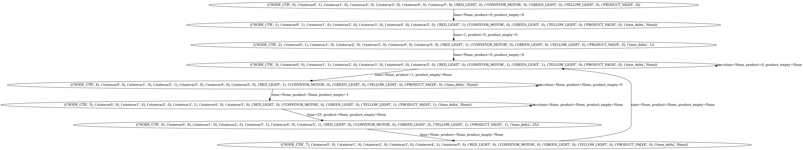
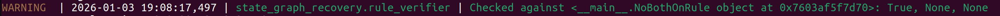
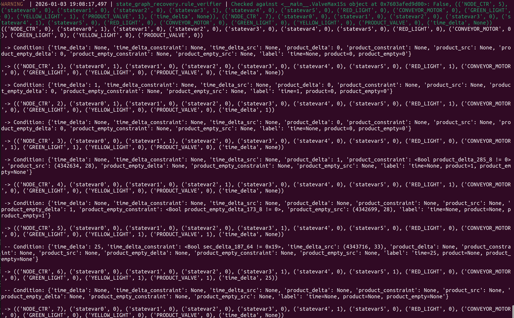

# Ta'veren

Ta'veren is a static analysis-based framework that recovers finite state machines (FSM) from PLC binaries and verifies safety policies to discover blind-trust vulnerabilities (BTV) in the PLC programs.
When PLC programs receive unexpected inputs (from peripherals) outside the consideration of PLC design, they may cause unsafe behaviors.
To find such vulerabilities, which may exist in "deep" part of the program, Ta'veren recovers the FSM implemented in the PLC program and applies model checking to verify safety policies against the recovered FSM.
To recover the FSM without suffering from state explosion, we build Ta'veren upon two ideas:
(1) deduplicate abstract states using state variables, and (2) discover meaningful input values that can trigger state transitions.
Our experiments show that Ta’veren recovers meaningful FSMs and uncovers safety violations with high effectiveness.

We describe the design and results of Ta'veren in our paper:  
[Discovering Blind-Trust Vulnerabilities in PLC Programs via Finite State Machine Recovery](https://bonnie1256.github.io/files/taveren.pdf)  
Fangzhou Dong, Arvind S Raj, Efrén López-Morales, Siyu Liu, Yan Shoshitaishvili, Tiffany Bao, Adam Doupé, Muslum Ozgur Ozmen and Ruoyu Wang  
_In Proceedings of Network and Distributed System Security (NDSS) Symposium 2026._

This repository includes the source code of Ta'veren and the dataset used in the paper.

## Overview
To use Ta'veren, you will need:
* The PLC binary (user input)
* The environment model that describes the interaction of the PLC with the physical world, which includes the addresses, sizes and types for input (sensor) and output (actuator) variables (user input, see [example](tests/packaging/packaging.json))
* The scan cycle function that implements the state machine (generated by [`taveren-scan-cycle`](src/taveren/scan_cycle.py))
* Initialization functions (generated by [`taveren-init-finder`](src/taveren/init_finder.py))
* State variables (generated by [`taveren-statevars`](src/taveren/statevars.py))
* Safety policies (user input, see [example](tests/packaging/test_packaging.py))

Ta'veren will output:
* The recovered FSM
* The verification results for the safety policies

## Command-line tools
Installing the package provides one command per pre-processing stage:

```
taveren-scan-cycle <binary>                         # detect the scan cycle function
taveren-init-finder <binary> <scan-cycle-func>      # rank initialization function candidates
taveren-statevars <binary> <scan-cycle-func>... [-o LOG]   # identify state variables
```

Functions are given as a hex address (`0x42C034`) or a symbol name (`loop`).

## Repository layout
* [`src/taveren/`](src/taveren/): the Ta'veren library and the command-line tools above
* [`tests/`](tests/): FSM recovery and policy verification for each target program, run with `pytest`
* [`tests/fixtures/`](tests/fixtures/): target programs' source code, binaries and reference FSMs used in the paper
* [`docs/`](docs/): Sphinx sources for the API documentation (see [Documentation](#documentation))
* [`experiments/`](experiments/): scripts that reproduce the paper's pre-processing results and the state reduction evaluation (Appendix F)

## Example outputs
An example recovered FSM:


An example verification result for a complied safety policy:


An example verification result for a violated safety policy:



## Prerequisites
* Python 3.12
* [graphviz](https://pygraphviz.github.io/documentation/stable/install.html) headers, needed to build pygraphviz
    > sudo apt-get install graphviz graphviz-dev

## Installation
All Python dependencies, including [angr](https://github.com/angr/angr) 10, are installed from PyPI.
Ta'veren used to rely on modified forks of angr and claripy; those modifications now live in
[`src/taveren/angr_compat.py`](src/taveren/angr_compat.py) and are applied when `taveren` is imported.

With [uv](https://docs.astral.sh/uv/):
> uv sync --extra test  
> uv run pytest

Or with pip inside a virtualenv:
> python3.12 -m venv .venv  
> . .venv/bin/activate  
> pip install -e '.[test]'

Install the `gui` extra to also get [angr management](https://github.com/angr/angr-management).

### Docker

The [`Dockerfile`](Dockerfile) installs Ta'veren and its dependencies with uv,
along with `tests/` and `experiments/`, so graphviz and Python 3.12 are not
needed on the host.

> docker build -t taveren .
> docker run --rm taveren pytest

The working directory inside the container is `/app`, so the bundled fixtures
can be analyzed directly, e.g. water tank 1:

> docker run --rm taveren taveren-scan-cycle tests/fixtures/water_tank/build/water_tank.so
> docker run --rm taveren taveren-init-finder tests/fixtures/water_tank/build/water_tank.so 0x41C24A

To analyze your own binaries or keep output files, mount a host directory:

> docker run --rm -v "$PWD/data:/data" taveren taveren-statevars /data/&lt;binary&gt; &lt;scan-cycle-func&gt; -o /data/statevars.log

Files written elsewhere in the container are discarded when it exits.  Pass
`--build-arg UV_EXTRAS="--extra test --extra gui"` to `docker build` to change
the installed extras.

## Documentation

The API reference for `src/taveren` is built with
[Sphinx](https://www.sphinx-doc.org/) from the sources in [`docs/`](docs/).
Every public module, class and function is documented from its docstring, with
examples.

### Building

Sphinx imports `taveren` to read its docstrings, so building needs the same
[prerequisites](#prerequisites) as installing the package (Python 3.12 and the
graphviz headers), plus the `docs` extra.

With [uv](https://docs.astral.sh/uv/):

```
uv sync --extra docs
uv run sphinx-build -M html docs docs/_build
```

`uv sync` removes extras that are not listed, so include the others you use,
e.g. `uv sync --extra test --extra docs`.

Or with pip inside a virtualenv:

```
pip install -e '.[docs]'
sphinx-build -M html docs docs/_build
```

[`docs/Makefile`](docs/Makefile) wraps the same commands: `make -C docs html`
(prefix with `uv run` when using uv).

### Viewing

Open `docs/_build/html/index.html` in a browser, or serve it locally and visit
<http://localhost:8000>:

```
python3 -m http.server -d docs/_build/html
```

### Rebuilding from scratch

Sphinx only rebuilds pages whose sources changed. After adding, removing or
renaming modules, clean the build output and the generated API pages first:

```
make -C docs clean
```

`docs/_build/` and `docs/api/generated/` are generated and ignored by git.

### Layout

* [`docs/conf.py`](docs/conf.py): Sphinx configuration; the version is read from `pyproject.toml`
* [`docs/index.rst`](docs/index.rst): the landing page
* [`docs/usage.rst`](docs/usage.rst): installation, command-line tools and documentation workflow
* [`docs/api/index.rst`](docs/api/index.rst): the API reference, generated recursively from `src/taveren`

### Writing documentation

Docstrings use the [Google style](https://www.sphinx-doc.org/en/master/usage/extensions/napoleon.html): a one-line summary, a description, then `Args:`, `Returns:`, `Raises:` and `Examples:` sections.
As in Rust, the examples are tests. Run them with:

```
uv run pytest --doctest-modules src/taveren
```

Mark examples that need a PLC binary or a long analysis with `# doctest: +SKIP`
so they are shown but not run.
Shared example data used across docstrings lives in [`conftest.py`](conftest.py).

Before submitting changes, check that the build has no warnings (`-W` turns them
into errors):

```
uv run sphinx-build -M html docs docs/_build -W --keep-going
```
